# Ishido for Windows

**A solitaire stone-laying game for Windows 3.1, written by Olaf Gottschalk
in Borland Pascal in 1993 and 1995.**

You get 72 gems, one by one, in a random order. Every gem has a colour and a
shape, and it has to go next to the gems already on the board, matching
them in colour or shape. Lay all 72 and you have won. Get stuck with a gem
that fits nowhere and you have lost. That is the whole game, and it is
surprisingly hard to win with a good score.

This repository is a museum. It contains the original source code and the
release archive as I found them on old backup CDs, the story of the game,
and a way to run and rebuild it today.

[](https://archive.softwareheritage.org/browse/origin/?origin_url=https://github.com/Zordid/ishido)

<!-- TODO(release): SWHID badge after the Software Heritage archive -->

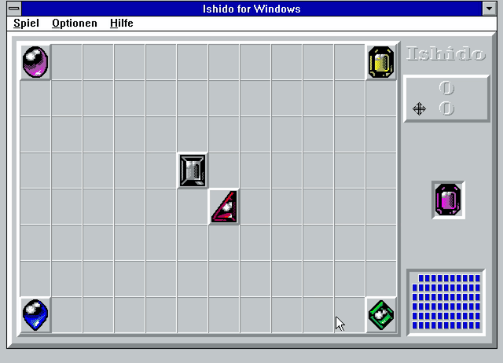

*Ishido 2.11 from 1995 running on Windows for Workgroups 3.11 in DOSBox-X,
in 2026, a won game in one minute. The game was played by a script, not by
hand – see [Played by a script](#played-by-a-script). The videos are in
[`docs/recordings`](docs/recordings): [`game-won.mp4`](docs/recordings/game-won.mp4),
[`game-lost.mp4`](docs/recordings/game-lost.mp4) and
[`intro.mp4`](docs/recordings/intro.mp4).*

| | |
|---|---|
| 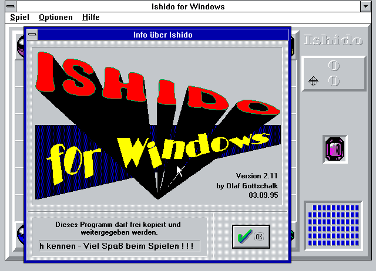 | 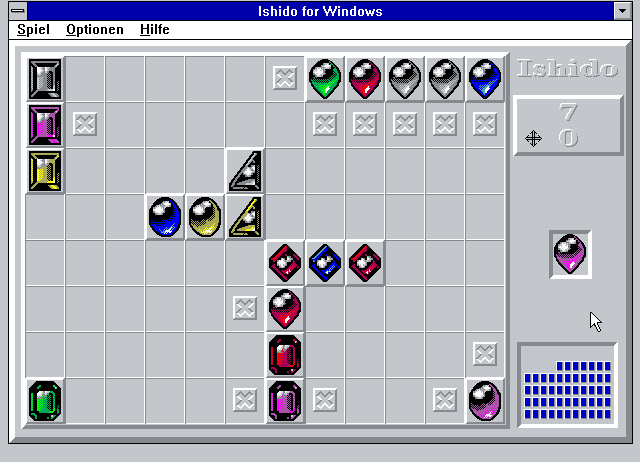 |
| 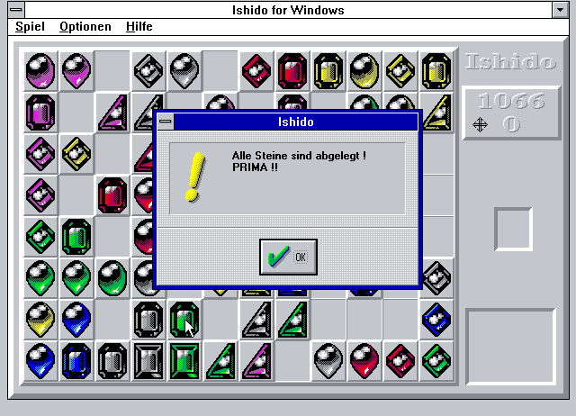 | 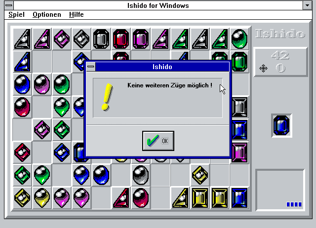 |
| 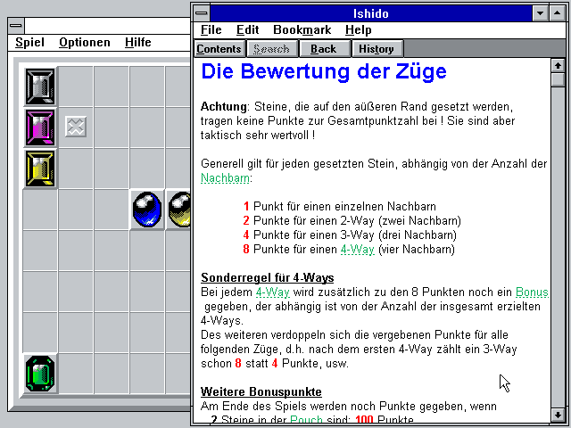 | 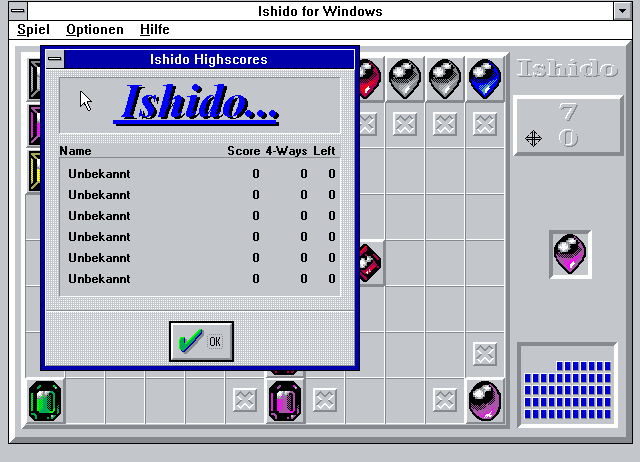 |
| 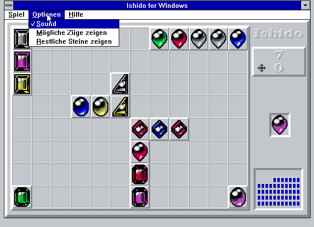 | 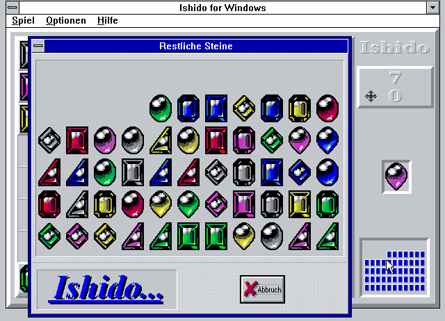 |

*The info dialog (top left) with the end of the greeting line, and below
it the line scrolling past. All pictures and videos show Windows for
Workgroups 3.11 in DOSBox-X in the standard VGA mode of Windows, 640 × 480
in 16 colours, which is what the game was made for, with the `BWCC.DLL` of
the release. The highscore list is that of a fresh installation.*

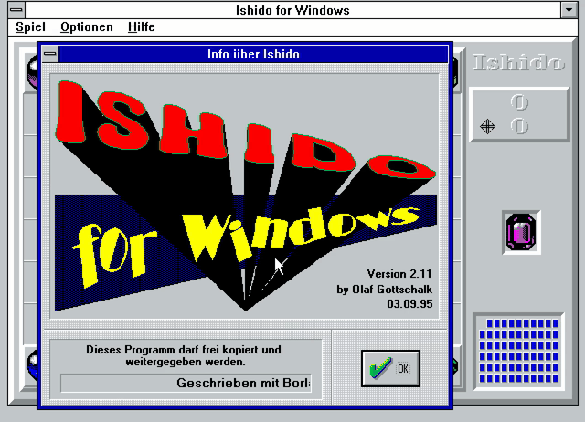

*A lost game: 70 of 72 stones laid, then a stone that fits nowhere.*

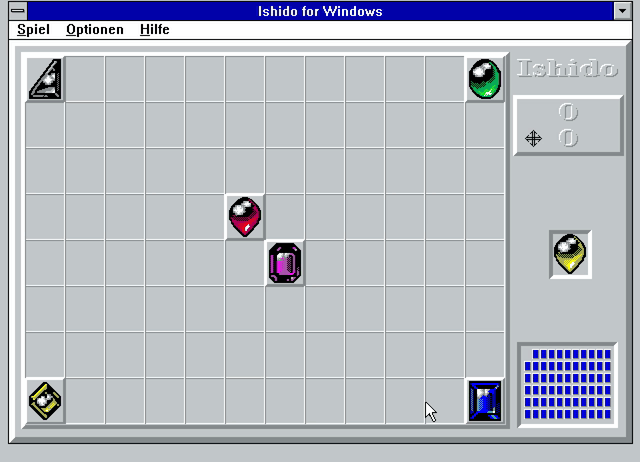

## The story

### The game

*Ishido: The Way of Stones* is an old game: Michael Feinberg designed it,
Publishing International made it, and Accolade published it in 1990 for the
Macintosh, DOS, Amiga and the Sega Mega Drive. It began as a hand-made
limited edition in a walnut box. Stones with six colours and six symbols
are laid on a board of 96 squares, in the same way as here, and the
manuals of the original also speak of the *pouch*, the bag the stones come
from. See [Wikipedia](https://en.wikipedia.org/wiki/Ishido:_The_Way_of_Stones).
Mine is an unofficial version. There were others: a Windows port written
in Borland C++ by Douglas Mayfield, with a tile set by Phat Tran, went
around on shareware CDs from April 1992 on. Its instructions give the same
scoring table as my help file, which probably means that both follow the
original game.

### My version

Facts from my own help file and the files in the archive:

- **10 January 1993:** the first test version, 1.0. Within the next two
  weeks came new stones, other rules and another scoring system (1.4), the
  functions to show the possible moves and the remaining stones (1.5), a
  highscore list (1.9), online help and the info dialog (2.0) and graphics
  for higher screen resolutions (2.01, 21 January 1993).
- It was written in *Turbo Pascal for Windows 1.5* with the ObjectWindows
  classes. I was inspired by an article in the magazine **WinDOS**: its
  logo is in the help file (`WINDOS.BMP`). The article described the
  skeleton of a program, and I extended it method by method. I cannot say
  today which issue it was, or how much of the skeleton is left: see
  [The missing article](#the-missing-article).
- **3 September 1995:** reworked for Borland Pascal 7.01 (2.10).
- **27 October 1995:** the first published version, 2.11. The release
  archive `Ishido.zip` is from **8 December 1995**. It says the game is
  freeware and may be passed on, with a donation welcome. I had only
  recently got into data communication (*DFÜ*) as a FidoNet point of the
  mailbox BooX; my Fido address is in the help file. Ishido had been
  lying around for more than two years before I gave it to the public.
- The About box scrolls: *Geschrieben mit Borland Pascal 7.01 – Viele Grüße
  an Ulli, Karsten, Niko, Judith, Holly, Christian, Franzi, Jens und alle
  die mich kennen – Viel Spaß beim Spielen ! ! !* Those are friends and
  former classmates, and Ulli, my girlfriend at the time, comes first for
  a reason.

### The missing article

My help file says I was inspired by an article in the magazine *WinDOS*,
and that I extended the skeleton of the program it described. **I
remember nothing about that article today**: not the issue, not the
author, and not how much of its code or its ideas I took over. That is a
gap in this museum, and it matters: code from a magazine listing would not
be mine.

What I could find out in 2026:

- *WinDOS* was a magazine about Windows. According to
  [German Wikipedia](https://de.wikipedia.org/wiki/Windows_Konkret) it was
  a spin-off of *DOS International* from the DMV publishing house, and the
  magazine *Windows Konkret* grew out of it in 1993. Its logo is the
  bitmap `source/WINDOS.BMP` in the help file.
- I was a subscriber to its parent, *DOS International*, so that is
  probably where I met WinDOS.
- It was around in 1992 and 1993: other magazines on the Internet
  Archive mention it, for example *PC Player* 1/1993.
- **No issue of *WinDOS* seems to be online.** The Internet Archive has
  scans of its parent *DOS International* up to 1993, and a full-text
  search for Ishido there finds many mentions of the board game in the
  magazines of the time, but no article about writing it for Windows.
  [Kultboy](https://www.kultboy.com/DOS-International-Zeitschrift/238/) lists
  the title without any issues. A normal web search finds nothing, as
  mine did.
- Printed copies very likely exist, in libraries (the Deutsche
  Nationalbibliothek collects German periodicals) and with collectors.
  So the article may be lost to the Internet, but not necessarily lost.

If you have an issue of *WinDOS* from late 1992 or early 1993, or know
where to find one, please open an issue in this repository. Until then the
README and the [LICENSE](LICENSE) say honestly that the origin of part of
the code is unknown.

### The pictures

- **The logo is mine.** The big *Ishido for Windows* with its 3D letters
  (420 × 255 pixels, 16 colours) and the small *Ishido…* banner of the
  other dialogs (170 × 45) are bitmaps inside `ISHIDO.RES`, with no
  drawing code at all. I made the 3D logo myself, with *WordArt*, I
  believe, the text effects program that came with an early version of
  Microsoft Works for Windows. That is my memory; I could not confirm which
  Microsoft product shipped it. The embossed look of the title and the
  score in the game window is another thing: that one is code, `Text3D`
  writes the text three times, shifted by a pixel.
- **The gems: I do not remember where they come from.** They may be my
  own, or they may have emerged elsewhere. What I can say after looking at
  the bitmap: the 36 stones are six drawings, one for each shape, and the six
  colours are the same drawing with other colours (outline and highlights
  are identical pixel for pixel, and the whole sheet has 14 colours). They
  are not from the 1992 port by Douglas Mayfield: that one has plain coloured
  squares with small symbol icons. Nor do they look like the stones of the
  original game by Accolade, as far as I could see: the DOS and Amiga
  screenshots I found (and one more of a version that is not named) show
  rounded tiles with a symbol on them, such as glyphs or Egyptian
  hieroglyphs, where my stones are gems of six shapes. I could not see the
  Macintosh, Mega Drive and Game Boy versions. If you recognise the gems,
  please open an issue.

### Looking back

**Why Ishido.** There was no special reason. Windows 3.1 itself had come
with Minesweeper and Solitaire, and games like those – card games, gem
games, games where you place things – were what made a PC fun in those
years. Ishido was one more of them: easy to play without much effort, and
simple enough to write.

**Typing in listings.** It came out of a magazine, and it is one of the
last traces of a habit I had for years: typing in code or ideas from
magazines like *Dr. Dobb's* and the German *PC Magazin Plus* and *DOS
International*; I was a subscriber to the last two. *PC Magazin Plus* was a
magazine of the Markt & Technik publishing house which, as far as I
remember, later became *PC plus* and *PC plus Technik*. I typed a listing in
quickly, fixed the typos and the bugs, and then, depending on how big and
deep the program was, either lost interest or kept adding to it. Some I
never understood. In my early years *PC Magazin Plus* printed a CAD
"program" that drew a Space Shuttle on a Hercules graphics card; it was
far too complex for me then. Some years later I learned that the author of
that listing was the older brother of a classmate, which amazed me. Other
listings were fun and simple, like this one. Earlier, in 1990, I had done
the same with Core Wars; my implementation, *Mars*, won the Central
Wyoming College programming contest.

*(What I could confirm about the magazines: PC Magazin Plus was published by
Markt & Technik from 1986, and a scanned issue of that year is on the
Internet Archive. A magazine called PC plus Technik, also from Markt &
Technik, existed in 1990; I could not confirm that it is PC Magazin Plus
under a new name, and I found nothing on a title just called PC plus. DOS
International was published by DMV, later WEKA, from 1987.)*

**The PC.** My first PC was an IBM XT clone from 1987: monochrome Hercules
graphics, a 20 MB hard disk, a 5.25" floppy drive. In 1991 came the first
386, probably with an early VGA card (I do not remember ever owning an EGA
card), and my first AdLib sound card. In 1992 or 1993 I upgraded to a
486/33, later to a 486DX4. I swapped components all the time, because I
got them from BCS: a steady flow of ever newer hardware. I always had the
latest version of Windows, delivered by BCS as well.

**January 1993.** I was at university, studying electrical engineering,
and January 1993 must have been a time without tests or stress. I do not
know why I rushed. In eleven days, from 10 to 21 January, the game went
from a first test version to 2.01, with help, an info dialog and graphics
for higher resolutions.

**Data communication, and a phone line.** In 1995 I got into *DFÜ* –
*Datenfernübertragung*, data communication. I think I started with a
modem that ran at 14.4 kbit/s; the one I remember best, a rather
uninspiring gray box, ran at 28.8 kbit/s. It sat on a serial port of my PC,
and I remember tweaking the settings of the port card and even upgrading
that card, because the UART was the problem. (The usual cure at the time
was a UART of the type 16550A, whose buffer coped better with the speed.)
As a point I used *CrossPoint*, and I remember fiddling around with *FOSSIL*
drivers. (CrossPoint, by Peter Mandrella, was a DOS program for reading and
writing the mail of FidoNet and other networks. FOSSIL, the *Fido/Opus/SEAdog
Standard Interface Layer*, was a standard that let such programs use the
serial port through a driver, for example X00 or BNU.)
First I shared the telephone line with my parents, which was horrible; soon I got a line of my own, and I remember
pulling cables through the house into my room, with my first very own
telephone and modem. I joined a local FidoNet net as a point of a mailbox
in Barsinghausen called BooX (probably with *Deister* in its full name), my
boss node. And that may have triggered my next move, two
years after I had written the game: I saw the network as a way to
distribute software by uploading it.

**My friends.** The friends in the greeting line were the people I spent
most of my time with, but our friendship had nothing to do with PCs, so I
don't think any of them ever played the game. When I put the freeware out,
I found it cool to let the world know who my friends were.

**Afterwards.** I probably uploaded Ishido only to BooX. I never pushed
it; it was not important after all. Nobody wrote to me about it.

**Reading it again.** My 500 random swaps to shuffle the stones: what a
strange way to randomize data! Today I would ask an AI chat and *know* the
best algorithm within seconds. Back then, in January 1993, on some Saturday
when I was coding a game on my PC, there was almost no way to get that kind
of information quickly.

## How to play

The board has 8 rows and 12 columns. Six stones are already on it: one in
each corner and two in the middle. All colours and all shapes appear. The
stone to lay next is shown at the right, the *touchstone*; below it the
*pouch* shows what is left, as blue backs. Click a free square to lay the
stone.

A stone can only go next to stones that are already there (left, right,
above or below, not diagonally), and it has to match its neighbours in
colour and/or shape:

| Neighbours | The stone fits if … |
|---|---|
| 1 | it matches that neighbour in colour or in shape |
| 2 | it matches one in colour and the other in shape (just two colours or just two shapes is not enough) |
| 3 | both colour and shape are matched at least once |
| 4 (a *4-way*) | it matches at least two in colour and at least two in shape |

The game ends when the pouch is empty (**won**), or when the stone to lay
fits nowhere (**lost**).

### Scoring

Only the inner 10 × 6 squares score; the outer ring brings nothing, but it
is tactically valuable.

| Neighbours | Points |
|---|---|
| 1 | 1 × factor |
| 2 | 2 × factor |
| 3 | 4 × factor |
| 4 (4-way) | 8 × factor, plus a bonus of 25, 50, 100, 200, 400, 600, 800, 1,000, 5,000, 10,000, 25,000, 50,000 for the 1st … 12th 4-way; then the factor doubles |

At the end: 100 points if 2 stones are left in the pouch, 500 for 1 stone,
and 1,000 if the pouch is empty. My help file says that scores over 2,000
with four to six 4-ways would soon be within reach. Building a 4-way is the
art: put stones of one colour left and right of a gap and stones of one
shape above and below, and then wait for the stone that fits. The help
file has a seven-step example for it, the bitmaps `source/EX1.BMP` to
`EX7.BMP`.

### Menus

*Spiel*: Neues Spiel, Rückgängig (one move back), Highscore Liste…,
Beenden. *Optionen*: Sound (a beep for a click that does nothing),
Mögliche Züge zeigen, Restliche Steine zeigen. *Hilfe*. Looking at the
possible moves or at the pouch is a help for beginners and costs you the
highscore list: the game warns you.

## How it is built

One Pascal file of 996 lines, `source/ISHIDO.PAS`: 5 object types, 43
procedures and functions, 23 virtual methods, no `goto` and 19 lines with
comments, most of them in German. It uses the units `WinProcs`,
`WinTypes`, `Objects`, `OWindows`, `ODialogs`, `OStdDlgs`, `BWCC` and
`Strings`. The compiler turns it into 21,863 bytes of code and 1,860 bytes of
data; with the Borland runtime the EXE is 88,064 bytes.

**Objects.** `TIshidoApp` (an ObjectWindows `TApplication`) only creates
the main window. `TIshidoWin`, a `TWindow`, *is* the game: state, rules,
drawing and mouse handling in one object. There are no child controls; the
board is painted directly. Menu commands arrive as ObjectWindows
messages (`CMNew`, `CMBackup`, `CMShowMoves` …), the mouse as
`WMLButtonDown`. Three small dialog objects show the info box
(`TInfoDlg`), the highscores (`THighScoreDlg`) and the rest of the pouch
(`TPouchDlg`).

**The board.** `Board: Array[0..XSize+1, 0..YSize+1] Of TStone` has an extra
empty frame around the 12 × 8 squares, so the rule check can look at all
four neighbours without ever testing for the edge. A `TStone` is two bytes,
shape and colour, and a shape of 0 means *empty*.

**The pouch.** At the start, 6 stones are chosen for the board, with six
different shapes and six different colours. The pouch is then filled with
all 36 colour/shape combinations, twice – except that a combination that
is already on the board is added only once: 66 stones. They are shuffled by
500 random swaps (more about that in the code review below). After that the pouch never changes: the game just
walks through the array with `PouchCnt`. This makes **undo** trivial: take
the stone off the board, move the pointer back by one, restore the score
and, if that move was a 4-way, halve the factor again. Undo goes back one
move only.

**The rules** are one function, `CheckPosition`, about 30 lines. For
every neighbour that is not empty it counts the matches in colour and in
shape separately, gives up when a neighbour matches neither, and then
applies the table above. The same function serves three purposes: it
decides whether a click is legal, it draws the hints (the little marks of
*Mögliche Züge zeigen*), and after every move `GetHints` runs it over all 96
squares to see whether any move is left – no move, game over.

**The pictures.** All 36 stones are in one bitmap, `STONES.BMP`
(205 × 266 pixels): shapes in the columns, colours in the rows, a grid of
34 × 41 pixels holding sprites of 33 × 40. At the start it is selected
into a memory device context once, and every stone is a single `BitBlt`.
The 3D look of the frames comes from `Rahmen`, which draws the bevel with
a white and a grey pen, line by line. `Text3D` writes the score and the
title three times, white, grey and light grey, one pixel apart. No
double buffering: the window is simply painted.

**The highscores** live in an INI file, as in many Windows programs of the
time: `High1N=` … `High6N=` for the names and `High1S=` … `High6S=` for the
rest, where the score, the stones left in the pouch and the number of 4-ways
are packed into one long integer and XORed with a constant, `$5115D04A`.
That is no real protection, but a score typed into the file by hand does
not read back as one. The file is called
`ENTPACK.INI`, a leftover from another program of mine, and it lands in the
Windows directory because there is no path in the name. `Sound` and
`ScrollSpeed` are stored there too.

**The scrolling greeting** is the oddest piece. The text is drawn once into
an off-screen bitmap, using a bold *MS Sans Serif* sized to fit the field.
The dialog then copies a window of that bitmap onto the screen, one pixel
further to the left each time. There is no timer: `CMInfo` runs its own
message loop, calling `PeekMessage` as fast as it can, and scrolls
every `ScrollSpeed` passes, a number you can set in the INI file (the larger,
the slower). Quirks: the speed depends on the processor, of course, and
the first time the program uses 100 and writes **60** into the file, so
it is faster from the second start on. On the emulated PCs of 2026,
whether at 486 or at Pentium speed, the banner races by; for the
recordings I set `ScrollSpeed=11000`, which measures about 46 pixels a
second, so that one pass of the line takes 36 seconds. The dialog is not modal: it disables the
main window and runs its loop itself. `/c` on the command line skips it.

**Resources.** `ISHIDO.RES` (the resource script it was made from did not
survive) contains the menu, the stone bitmap, the three dialogs (in the
*BWCC* style of Borland's *Windows Custom Controls*, which is why
`BWCC.DLL` is part of the release) and a string table for the messages,
read by `GetString`.

**Help.** `ISHIDO.RTF` and `ISHTERMS.RTF` are the sources of the Windows
help file: contents, about, rules, scoring, tips and tricks, the seven
example screens and a glossary, compiled with `HC31` from the
Windows SDK (`ISHIDO.HPJ`). The program starts it with `WinHelp` and closes
it again on exit.

## Played by a script

Whether the game is any good can be tested: `tools/play-ishido.py` plays
it, by looking at the screen like a patient human. It takes a screenshot
of the emulated PC, recognises the next stone and the six start stones by
comparing them with the sprites in `STONES.BMP`, knows the rules from
`CheckPosition`, and keeps track of the pouch: it knows which of the 72
stones it has not seen yet. For every legal square it asks how many of the
remaining stones would still have a place afterwards, and takes the
move that leaves most; four-ways are preferred. Then it clicks.

The script does not look into the program's memory and the game is not
changed in any way. After every click it looks at the square it clicked, and
if the stone is not there it stops, so a wrong picture of the board can not
spoil a recording. For the videos, DOSBox-X is stopped while the script is
thinking, and the identical frames are dropped when the video is made.

In 11 full games it won 5 and lost 6, the losses with 67 to 71 of the 72
stones laid. The wins scored 1055, 1057, 1066, 1090 and 1111 points: the 1,000
for the empty pouch and a little over, with no more than one 4-way. That is far from
the 2,000 and more that my help file promises, and a human who plays for
4-ways could do better than the script, which only tries to survive.

## A code review, thirty years late

*Olaf asked Claude for a few notes on the code, the way he did for Kiosk
and Power-Choice. Here they are.*

**Verdict: approved, with comments.** A one-file game of its size is
easy to read, and it is clear that it grew: from an article's skeleton, to
a Windows 3.1 program in Turbo Pascal for Windows, to Borland Pascal 7.01.

What works:

- **The empty frame around the board** – no bounds checks anywhere.
- **One pouch array for everything**: shuffle once, walk through it, and
  undo and the pouch dialog come for free.
- **One rule function** for clicks, hints and the end of the game.
- **The data is cleanly separated from the code**: resources, bitmap and
  help live in their own files.

What I would have asked about:

- **`Score` is a `Word`.** Range checking is off (`{$R-}`), so it would wrap
  silently at 65,535. The bonus table has 12 entries; a 13th 4-way would
  read past its end. Neither is likely in a real game, but the highest
  bonus alone is 50,000.
- **The shuffle.** The pouch is mixed by 500 swaps of two random positions.
  That is a known method, a *random transposition shuffle*, and it is enough:
  for 66 stones it is random after about 138 swaps (½ · n · ln n), and after
  500 the position of a single stone differs from a perfectly even spread by
  about 2 in 10 million. But the *Fisher–Yates* shuffle does the same job
  exactly, in 65 swaps. The real limit is the seed: `Randomize` fills a
  32-bit number from the clock, so the game knows at most 2³², about 4.3
  billion, different deals. There are about 2.6 × 10⁸⁹ different games (5 × 10⁸³
  orders of the pouch, because the twin stones look alike, times 518,400
  layouts of the six start stones), so a 32-bit seed reaches 1.6 in 10⁸⁰ of
  them. To reach every game, the seed would need about 298 bits, about 38
  bytes. The clock alone gives only about 23 bits a day (hundredths of a
  second); in 1993, on a DOS PC, the way to more was to collect many unpredictable
  moments, such as the timer counter at every keystroke and the mouse
  movements, a bit or two each, and to feed a bigger generator with them. A
  modern computer asks the operating system for random numbers instead.
  Nobody needs that for a game, but the principle matters: in 1999
  researchers showed that the shuffle of an online poker site, which also
  swapped pairs of cards and was seeded from the clock, left only about
  200,000 possible decks, and that they could work out the deck being dealt
  (Arkin et al., Reliable Software Technologies; see
  [Scientific American](https://www.scientificamerican.com/article/how-the-math-of-shuffling-cards-almost-brought-down-an-online-poker-empire/)).
- **The defensive checks** (`FEHLER: Pouchgröße !`) in `InitGame` show
  some distrust of the fill loop, and with the trick that a stone is only
  doubled if it is not already on the board, that is understandable.
- **`DrawStone` computes a variable `Beyond`** (the outer ring) and never
  uses it.
- **The scroller counts idle loops**, not time. A `SetTimer` would have run
  at the same speed on every machine – and would not have needed the
  `ScrollSpeed` setting at all.
- **Highscores in an INI file** named after another program, written to
  the Windows directory.

None of that kept it from being played: the game has only one job and does
it.

## Version history

| Version | Date | What |
|---|---|---|
| 1.0 | 10 Jan 1993 | First test version |
| 1.4 | 13 Jan 1993 | New stones, other rules and scoring |
| 1.5 | 15 Jan 1993 | *Mögliche Züge zeigen* and *Restliche Steine zeigen* |
| 1.9 | 17 Jan 1993 | Bugs fixed, highscore list |
| 2.0 | 19 Jan 1993 | Online help and info dialog |
| 2.01 | 21 Jan 1993 | Bugs fixed, better graphics, higher resolutions |
| 2.10 | 3 Sep 1995 | Reworked for Borland Pascal 7.01 |
| **2.11** | 27 Oct 1995 | **First published version**; `Ishido.zip` of 8 Dec 1995 |

Only **2.11** survives, in two forms: the source archive and the release
archive. Everything before it is known only from this list.

## Repository layout

```
source/     the source archive of October 1995: ISHIDO.PAS, the resources
            (ISHIDO.RES, the bitmaps of 1993), the help sources, batch files
release/    the release archive Ishido.zip of December 1995, unpacked:
            ISHIDO.EXE, ISHIDO.HLP, BWCC.DLL, README.TXT, FILE_ID.DIZ
docs/       screenshots and recordings, social-preview.png (the picture for
            the GitHub repository card)
tools/      build-ishido.sh, play-ishido.py, record-ishido.sh, cut-video.sh,
            cut-game.sh, social-preview.py, redact.py, fat12.py
```

The repository has two commits for the originals, with their original dates
(27 October and 8 December 1995), tagged `v2.11-source` and `v2.11`, and
one for everything that was added in 2026.

## Running it

**On Windows 3.1x** (it also runs on Windows 95 and NT, as the old README
says): copy `ISHIDO.EXE`, `ISHIDO.HLP` and `BWCC.DLL` from `release/` into a
folder and start `ISHIDO.EXE`. In the Program Manager, use *File | New*.
The game needs no files in the Windows system directory.

**Today:** you need a Windows 3.1 or 3.11 installation, which I cannot
provide, in an emulator such as [DOSBox-X](https://dosbox-x.com/) or
[86Box](https://86box.net/). I used Windows for Workgroups 3.11 in DOSBox-X,
a Tseng ET4000 with the standard VGA driver (640 × 480, 16 colours), as for the Kiosk
repository. There is **no browser demo**: it would have to ship Windows. If you
just want to play Ishido, see
[Other ways to play Ishido today](#other-ways-to-play-ishido-today).

**A note on `BWCC.DLL`.** The release brings the version of 14 April 1993
(152,064 bytes): Borland's own DLL of Borland Pascal 7.0, in its German
edition, so the buttons of the message boxes say *Ja*, *Nein* and *Abbruch*.
It works as it should in the standard VGA mode of Windows, 640 × 480 in 16
colours, which is what the game was made for, and all the pictures and
videos here were made that way. On a 256-colour Super VGA screen it is
another story: in my emulated PC at 1024 × 768 the backgrounds of its
dialogs have gaps, and the board shines through them. A newer, English
`BWCC.DLL` of 28 February 1995 (164,928 bytes), which stood next to
`ISHIDO.EXE` on my own PC, does better there. I did not look for the
reason. In this repository the release stays as I found it.

## Other ways to play Ishido today

If you want to play the game and not to run a program from 1995, here is
what I found in October 2026. I have not tested any of it, and links
change.

- **In the browser:** [Ishid-O-Matic Reborn](https://infini-creation.itch.io/ishid-o-matic-reborn)
  on itch.io, by Infini-Creation, plays in the browser and also exists for
  Windows, macOS and Linux. It is a remake of *Ishid-O-Matic* by Robert
  Brander (Amiga, 1992), a game that was itself inspired by Ishido, made
  with Godot; the source is on GitHub, the artwork is under CC BY-NC-SA
  4.0. For Safari and iOS there is a
  [separate build](https://infini-creation.itch.io/ishid-o-matic-reborn-fixed-for-safari).
- **On the iPhone:** [Ishido – The Way of the Stones](https://apps.apple.com/us/app/ishido/id1314137178)
  by Darin Koenig, free. The developer says it follows the rules of the
  original game; the reviews miss the opening layout and the I Ching
  oracle of the original. I found no Android version.
- **The original, on old consoles:** the Game Boy, Atari Lynx, Sega Mega
  Drive and Famicom Disk System versions of 1990 and later can be played in
  browser emulators. I do not link those pages, because the legal status of
  ROM sites is unclear.
- **Another Windows 3.x version:** the port by Douglas Mayfield of April
  1992, mentioned [above](#the-game), is on many CD images, for example
  [here](https://discmaster.textfiles.com/browse/30641/visualcdgame.iso/wingames/ishido/ishido.zip).
- **With source code:** [doishi](https://sourceforge.net/projects/doishi/)
  (BlitzMAX, GPLv2), [P-Ishido](https://sourceforge.net/projects/palmishido/)
  for Palm OS, an X11 version in the
  [FreeBSD ports](https://www.freshports.org/games/ishido), and
  [The Enchanted Stones of Cameronne](https://blue-genie.itch.io/the-enchanted-stones-of-cameronne),
  an Ishido-style game for the Amstrad CPC.

I found no faithful HTML5 clone of the 1990 game, and none of these is a
version of mine.

## Building it

You need Borland Pascal 7.0 or 7.01. `tools/build-ishido.sh` takes the
compiler, the ObjectWindows and the Windows 3.1 units from the eleven
BP 7.0 installation disk images and runs `BPC /CW` in DOSBox-X:

```
BP7_DISKS=".../Borland Pascal 7.0 (3.5)" tools/build-ishido.sh source /tmp/ishido
```

It compiles all 997 lines without changes, and the EXE has the **same size
as the one from 1995, 88,064 bytes**, but 1,340 bytes differ: I only have
the 7.0 disks, and the About box says 7.01. Everything the program needs
is there: the resources, the bitmaps, `BWCC`. The help file needs the Help
Compiler `HC31` of the Windows SDK, which came with Borland Pascal as well
(`WINUTILS.ZIP`, disk 6).

## Notes on this archive

- **Freeware:** Ishido was always freeware, as the README and the help
  file say. The folder `Shareware` on my backup CDs, where the files were
  found, is only the folder where I kept my released programs.
- **Sources:** `Ishido.zip` and `Ishido Source.arj`, found on backup CDs,
  and a second copy of the game with a newer `BWCC.DLL` in my games folder.
  The two copies of `ISHIDO.EXE` and `ISHIDO.HLP` are identical. No other
  versions turned up, and no records of registrations.
- **Conversions:** the text files are converted to UTF-8, with the CRLF line
  endings kept: `ISHIDO.PAS`, `README.TXT` and `FILE_ID.DIZ` from
  Windows-1252, `INSTALL.BAT` from code page 437. To compile,
  convert the Pascal file back with `iconv -f UTF-8 -t CP1252`. The `.RTF`
  files are plain ASCII with escapes, the `.DOC` files are Word documents,
  and the binaries are byte for byte as found.
- **Redacted:** my street address and my old bank account in `README.TXT`,
  `ISHIDO.RTF` and `ISHIDO.DOC` are replaced by `x` of the same length. The
  help file in `release/` is therefore **not** the original (its About page
  with the `x` lines: [`docs/screenshots/help-about.png`](docs/screenshots/help-about.png)): I compiled it
  again from the redacted RTF with the original Help Compiler. The
  original has 35,932 bytes; compiling its unredacted source again gives
  the same size but not the same bytes (the compiler stores times and
  layout), and the redacted one has 35,934. My Fido address stays.
- **Left out:** `ISHIDO.GID` (the cache Windows made of the help file in
  2000).
- **`INSTALL.BAT`** in the source archive is a leftover from January 1993:
  it unpacks an `INSTALL.DAT` that no longer exists.
- **Not in the archive:** the versions before 2.10, and the article of the
  *WinDOS* magazine (see [The missing article](#the-missing-article)).

## Third-party code

- **`BWCC.DLL`** is Borland's *Windows Custom Controls* library, (c) Borland
  International, which came with the release archive in 1995 and stays
  with its owner. It is the version of 1993, as in the release; the one of
  1995 is not in the repository.
- **The stone pictures** (`source/STONES.BMP` and the same sheet in
  `ISHIDO.RES`): I do not remember who drew them
  ([The pictures](#the-pictures)).
- **The game itself** is not mine: *Ishido* was designed by Michael
  Feinberg and published by Accolade. This is an unofficial version,
  written from the rules.
- **The program skeleton** from the *WinDOS* article: I do not know how
  much of it is left in `ISHIDO.PAS`, and I could not find the article
  ([The missing article](#the-missing-article)).
- `ISHIDO.PAS` also uses ObjectWindows, the Windows API units and the BWCC
  unit of Borland Pascal, which are not in the repository.

## License

[MIT](LICENSE), for everything I wrote, then and now. The exceptions –
Borland's `BWCC.DLL`, and the part of `ISHIDO.PAS` that may come from the
magazine article – are listed in the LICENSE file. The names of the
games and products shown belong to their respective owners.
